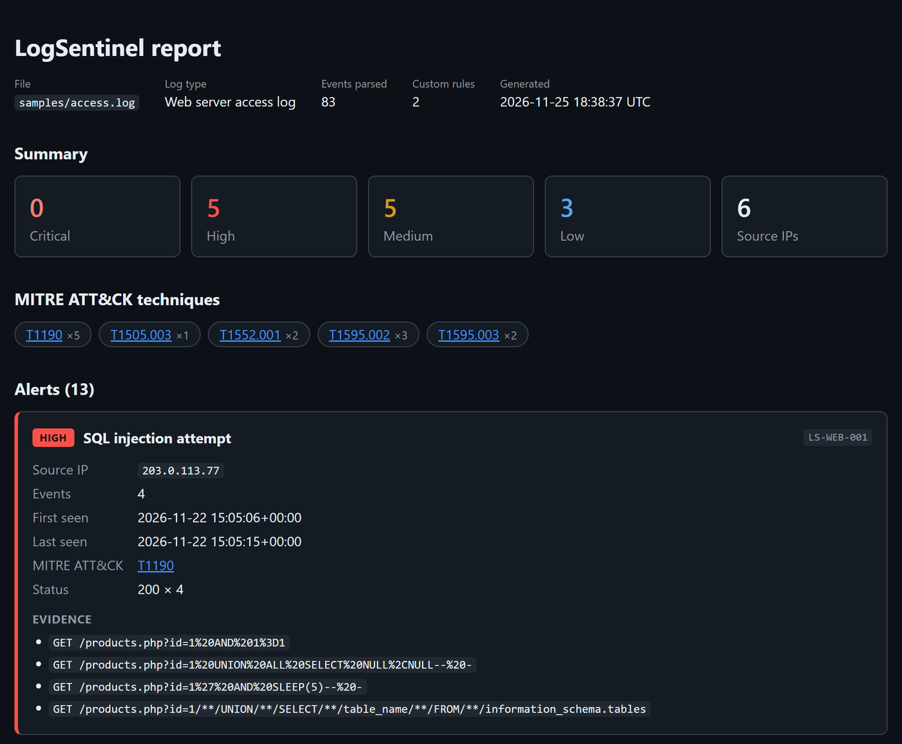

# 🛡️ LogSentinel


**LogSentinel** is a lightweight CLI with no required dependencies that detects attacks in Linux and web server log files
and maps every alert to **MITRE ATT&CK**. It's built to show how SOC detection logic works
under the hood — the same ideas SIEMs like Splunk, Elastic or Wazuh apply at scale.

## Features

| Detection | Rule | MITRE ATT&CK | Status |
|---|---|---|---|
| SSH brute force (one user, many attempts) | LS-SSH-001 | [T1110.001](https://attack.mitre.org/techniques/T1110/001/) | ✅ |
| SSH password spraying (many users) | LS-SSH-001 | [T1110.003](https://attack.mitre.org/techniques/T1110/003/) | ✅ |
| Successful login after brute force (likely compromise) | LS-SSH-001 | T1110 + [T1078](https://attack.mitre.org/techniques/T1078/) | ✅ |
| SQL injection attempts | LS-WEB-001 | [T1190](https://attack.mitre.org/techniques/T1190/) | ✅ |
| Cross-site scripting (XSS) attempts | LS-WEB-002 | [T1190](https://attack.mitre.org/techniques/T1190/) | ✅ |
| Path traversal / local file inclusion | LS-WEB-003 | [T1190](https://attack.mitre.org/techniques/T1190/) | ✅ |
| Directory / file brute force (behavioural) | LS-WEB-004 | [T1595.003](https://attack.mitre.org/techniques/T1595/003/) | ✅ |
| Known scanner User-Agents (Nikto, sqlmap, gobuster, ffuf…) | LS-WEB-005 | [T1595.002](https://attack.mitre.org/techniques/T1595/002/) | ✅ |
| Log4Shell ([CVE-2021-44228](https://nvd.nist.gov/vuln/detail/CVE-2021-44228)), incl. obfuscated payloads in headers | LS-WEB-006 | [T1190](https://attack.mitre.org/techniques/T1190/) | ✅ |
| Custom rules in Sigma format (web and sshd subsets) | rule `id` | from the rule's `attack.tXXXX` tags | ✅ |
| Self-contained HTML report (`--html`) | — | — | ✅ |
| IP reputation from AbuseIPDB (`--enrich`, opt-in) | — | — | ✅ |

## Quick start

```bash
git clone https://github.com/FMBeca/logsentinel.git
cd logsentinel
pip install -e ".[yaml]"          # or just "." if you don't need Sigma rule files
logsentinel ssh samples/auth.log --year 2026
logsentinel web samples/access.log --rules rules/ --html report.html
```

Example output:

```
[CRITICAL] Successful login after SSH brute force  (LS-SSH-001)
    IP: 203.0.113.5  events: 6  MITRE: T1110.001, T1078
    2026-11-22 14:01:02 -> 2026-11-22 14:01:12
    users: root
    !! login succeeded as 'root'

[HIGH] SSH password spraying  (LS-SSH-001)
    IP: 192.0.2.44  events: 5  MITRE: T1110.003
    users: admin, oracle, pi, test, ubuntu
```

Web log analysis of [`samples/access.log`](samples/access.log) — SQLi, Log4Shell, path traversal,
XSS, and two wordlist scans, one of them hiding behind a browser User-Agent:

<p align="center">
  
</p>

Analyze your own server (read-only):

```bash
sudo logsentinel ssh /var/log/auth.log          # Debian/Ubuntu
sudo logsentinel ssh /var/log/secure --json     # RHEL/Fedora, JSON output
sudo logsentinel web /var/log/nginx/access.log
sudo logsentinel web /var/log/apache2/access.log --json

# Systems without /var/log/auth.log (journald only, e.g. a minimal Debian 12):
journalctl -u ssh -o short-iso --no-pager | logsentinel ssh -      # service "sshd" on RHEL/Fedora
```

Syslog timestamps are read in both formats: classic (`Nov 22 14:01:02`, no year, so `--year`
sets it) and RFC 3339 (`2026-11-22T14:01:02.123456+00:00`), the rsyslog default on current Ubuntu
and Debian. A log whose lines are not recognised at all is reported as an error instead of
"No threats detected".

| Command | Options |
|---|---|
| `ssh` | `--threshold N` (default 5), `--window SECONDS` (default 300), `--year YYYY` (classic timestamps only) |
| `web` | `--scan-threshold N` distinct 403/404 paths (default 20), `--scan-window SECONDS` (default 60) |

Both accept `--rules PATH` (repeatable), `--enrich`, `--json`, `--no-color`, `--html FILE` and `-` to read from stdin.
The exit code is `1` when threats are found, so it can be used in scripts and cron jobs,
and `2` when a rule file cannot be loaded, `--enrich` has no API key or the log format is not recognised.

## HTML report

```bash
logsentinel web samples/access.log --rules rules/ --html report.html
```

`--html` writes a single file that opens in any browser, works offline and can be attached to a
ticket: a summary by severity, the MITRE ATT&CK techniques seen (linked to attack.mitre.org) and every
alert with its evidence. The console output and exit code stay the same.

<p align="center">
  
</p>

Log lines are attacker-controlled, so a report that pasted them into HTML would run an attacker's XSS
payload in the analyst's browser. Every value is HTML-escaped, and the page carries a
Content-Security-Policy that blocks scripts and remote resources as a second layer; the tests feed
XSS payloads through every field of an alert to check both.

## IP reputation (AbuseIPDB)

`--enrich` adds the [AbuseIPDB](https://www.abuseipdb.com) reputation of each source IP to the
alerts: abuse confidence score, number of reports, country, ISP and Tor exit node flag. It is off by
default because it sends IP addresses to a third party and needs a free API key:

```powershell
$env:ABUSEIPDB_API_KEY = "<your key>"           # PowerShell; on Linux: export ABUSEIPDB_API_KEY=...
logsentinel ssh /var/log/auth.log --enrich --html report.html
```

Example output (illustrative values; documentation IPs like this one are never actually looked up):

```
[CRITICAL] Successful login after SSH brute force  (LS-SSH-001)
    IP: 203.0.113.5  events: 6  MITRE: T1110.001, T1078
    reputation: 100/100 abuse score · 42 reports · NL · Example Hosting (AbuseIPDB)
```

- The key is read from the `ABUSEIPDB_API_KEY` environment variable only: a command-line argument
  would be saved in shell history and visible in the process list. It is sent in a header, never in the URL.
- Only globally routable addresses are looked up. Private, loopback and documentation ranges
  (including every IP in `samples/`) never leave the machine, and each IP is queried once per run.
- Enrichment never blocks detection: a rejected key, an exhausted quota or no network produce a
  warning, and the alerts are reported without reputation data.
- Reputation text comes from a third party, so the HTML report escapes it like log content.

## Custom rules (Sigma format)

[Sigma](https://github.com/SigmaHQ/sigma) is the open format SOC teams use to share detection
rules. Both commands can load extra rules written in a subset of it, on top of the built-in ones.
A rules folder can mix both kinds: each command keeps the rules for its own log source.

```bash
pip install -e ".[yaml]"                      # PyYAML is only needed for rule files
logsentinel web samples/access.log --rules rules/
logsentinel ssh samples/auth.log --year 2026 --rules rules/
```

```yaml
title: Web shell access attempt
id: 81e90d38-7eac-48ec-9c90-939a75ecabb4
tags: [attack.persistence, attack.t1505.003]
logsource:
  category: webserver
detection:
  selection_name:
    cs-uri-stem|endswith: [/shell.php, /cmd.php, /c99.php]
  selection_param:
    cs-uri-stem|endswith: .php
    cs-uri-query|contains: [cmd=, exec=]
  condition: 1 of selection_*
level: high
```

Linux rules follow Sigma's own convention for syslog: keyword lists searched in each line, since
these lines have no standard fields. sshd logs much more than logins, and these lines catch what the
brute-force detector cannot see:

```yaml
title: SSH port scan or banner grab
tags: [attack.reconnaissance, attack.t1595]
logsource:
  product: linux
  service: sshd
detection:
  keywords:
    - Did not receive identification string from
    - Bad protocol version identification
  condition: keywords
level: low
```

Example rules:

| Rule | Log | MITRE ATT&CK |
|---|---|---|
| [Web shell access attempt](rules/web/webshell_access.yml) | web | T1505.003 |
| [Probe for backup, dump or secrets files](rules/web/sensitive_file_probe.yml) (`.bak`, `.sql`, `.env`, `.git`) | web | T1552.001 |
| [SSH port scan or banner grab](rules/linux/sshd_scan_banner_grab.yml) | sshd | T1595 |
| [Suspicious OpenSSH protocol or crypto error](rules/linux/sshd_suspicious_errors.yml) (exploit attempts, fuzzing) | sshd | T1190 |

| Supported | |
|---|---|
| Log source | `category: webserver` (`product: apache` / `nginx` or none); `product: linux` with `service: sshd` / `auth` (keywords only) |
| Fields | `c-ip`, `cs-method`, `cs-uri`, `cs-uri-stem`, `cs-uri-query`, `cs-version`, `sc-status`, `sc-bytes`, `c-useragent`, `cs-referer` |
| Values | case-insensitive, `*` / `?` wildcards, lists (OR), `null`, keyword lists (raw line) |
| Modifiers | `contains`, `startswith`, `endswith`, `all`, `re` (`re\|i` for case-insensitive) |
| Conditions | `and`, `or`, `not`, parentheses, `1 of x*`, `all of x*`, `1 of them`, `all of them` |

URL and header fields are matched both as logged and after normalization, so a rule written for
`' or 1=1` also catches `%27%20or%201%3D1`. Anything outside this subset (aggregations, `timeframe`,
other log sources, unknown modifiers or fields) is **rejected with an error** instead of being skipped:
a rule that loads but can never fire gives a false sense of coverage.

## How detection works

### SSH

1. **Parse** — regexes normalize `sshd` lines (classic or RFC 3339 timestamps) into `AuthEvent`
   objects (time, IP, user, success).
2. **Sliding window** — for each source IP, failed attempts are kept in a time window.
   When the count crosses the threshold, an alert is raised.
3. **Classify** — ≥3 distinct usernames ⇒ *password spraying*; otherwise *brute force*.
4. **Correlate** — a successful login from an IP with an active alert escalates it to **CRITICAL**
   and adds T1078 (Valid Accounts): the attacker now holds working credentials.

```
auth.log ─► parser ─► AuthEvent stream ─► detector (sliding window per IP) ─► Alerts ─► table / JSON
```

### Web (Apache / Nginx)

1. **Parse** — the Combined Log Format (and the shorter Common Log Format) is normalized into
   `HttpEvent` objects. Malformed requests, such as TLS handshakes sent to a plain-HTTP port,
   are kept because they are often interesting.
2. **Normalize** — the request target is URL-decoded **twice** (to defeat double encoding such as
   `%2527` → `%27` → `'`) and SQL inline comments (`/**/`), a common way to replace spaces, are stripped.
3. **Signatures** — regex rules for SQLi, XSS and path traversal run against every request.
   They are tested against benign look-alikes (`?q=select+your+plan`, `/docs/../img/logo.png`)
   to keep false positives down. The Log4Shell rule also inspects the User-Agent and Referer,
   where that payload was usually sent, after unwrapping Log4j lookups used to hide it
   (`${${lower:j}ndi:...}` → `${jndi:...}`).
4. **Behaviour** — per source IP, a sliding window counts *distinct* paths answered with 403/404.
   A User-Agent can be changed with one flag (`gobuster -a`), so this is what catches wordlist
   scanners that pretend to be a browser; the User-Agent rule is only a low-confidence extra signal.

> Signature hits are **attempts**, not proof of compromise: a `200` response to a SQLi payload
> may simply mean the application ignored it. Status codes are included in every alert to help triage.

## Project structure

```
src/logsentinel/
├── cli.py                 # command-line interface
├── models.py              # AuthEvent, LogLine, HttpEvent, Alert, Severity
├── sigma.py               # Sigma-style YAML rule loader and matcher
├── report.py              # self-contained HTML report
├── enrich.py              # optional AbuseIPDB IP reputation
├── parsers/
│   ├── ssh.py             # OpenSSH login attempts
│   ├── syslog.py          # any syslog line, for keyword rules
│   └── web.py             # Apache/Nginx access log parser
└── detectors/
    ├── bruteforce.py      # SSH brute force / spraying
    ├── linux.py           # Sigma keyword rules on syslog lines
    └── web.py             # SQLi, XSS, traversal, scanners
rules/web/, rules/linux/   # example rules in Sigma format
tests/                     # pytest suite (run in GitHub Actions)
samples/                   # synthetic logs (RFC 5737 documentation IPs)
scripts/gen_access_log.py  # regenerates samples/access.log (kept in sync by a test)
```

## Development

```bash
pip install -e ".[dev]"
pytest -v && ruff check .
```

## Roadmap

- [x] SSH brute force / spraying / compromise detection
- [x] Apache/Nginx parser with SQLi, XSS, path traversal and scanner detection
- [x] Custom rules in Sigma format (web subset)
- [x] Sigma keyword rules for sshd logs
- [x] HTML report
- [x] IP reputation enrichment (AbuseIPDB, opt-in)

## License

MIT
